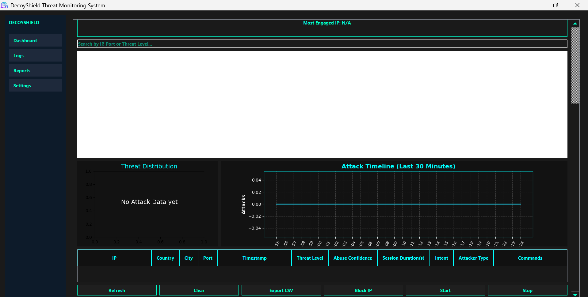

# 🛡️ DecoyShield
### A Deception-Based Framework for Proactive Threat Detection and Cyber Defense

DecoyShield is a Python-based cybersecurity project that explores **honeypot technology and cyber deception** to monitor suspicious network activity, collect attack-related information, and analyze potential attacker behavior in a controlled environment.

The framework uses simulated network services to attract suspicious connections and observe interactions, demonstrating how deception-based techniques can support proactive threat monitoring.

---

## 📌 Project Overview

Traditional security mechanisms often focus on detecting threats through conventional security controls and monitoring systems. DecoyShield explores an additional layer of defense through deception-based techniques.

The project focuses on:

- Network activity monitoring
- Attacker behavior analysis
- Threat classification and risk scoring
- Attack information logging
- Threat intelligence enrichment
- Security event visualization

## ✨ Key Features

- **Multi-Port Honeypot:** Simulates network services on decoy ports to observe incoming connections.
- **Behavioral Analysis:** Examines connection patterns and suspicious network activity.
- **Threat Classification:** Uses risk scoring to categorize suspicious activity into LOW, MEDIUM, and HIGH levels.
- **Adaptive Deception:** Explores simulated service responses and controlled interactive environments.
- **Threat Intelligence Integration:** Integrates AbuseIPDB to retrieve IP reputation information, including abuse confidence scores and report counts.
- **Attack Logging:** Uses SQLite for storing attack-related information.
- **Email Alerts:** Supports email notifications for security events.
- **Web Dashboard:** Provides a graphical interface for monitoring attack activity and displaying security information.

*Note: Features described in the proposed framework and research documentation may differ from the functionality implemented in individual project versions.*

## 🧰 Technologies Used

| Category | Technologies |
|---|---|
| Programming Language | Python |
| Web Dashboard | PyQt5 |
| Database | SQLite |
| Data Visualization | Matplotlib | 
| Attack Map Visualization | Folium |
| Networking | Python Socket Programming |
| Network Testing | Nmap, Netcat |
| Threat Intelligence | AbuseIPDB API |
| Notifications | SMTP Email Alerts |
| Platform | Windows |

## 🏗️ System Architecture

The proposed DecoyShield framework consists of six major layers:

1. **Network and Access Layer** – Handles incoming network connections.
2. **Intelligence API Layer** – Retrieves external threat intelligence.
3. **Analytics and Decision Engine** – Analyzes activity and calculates risk scores.
4. **Deception Layer** – Provides simulated services and controlled interactions.
5. **Storage and Alerting Layer** – Maintains attack records and security notifications.
6. **User Interface Layer** – Presents monitoring information through the web dashboard.

## 🔍 Threat Intelligence and Risk Scoring

DecoyShield integrates AbuseIPDB to enrich suspicious IP addresses with external reputation information.

The integration retrieves:

- Abuse confidence score
- Total reported incidents

A custom risk-scoring mechanism considers reputation information, observed behavior, and VPN/proxy indicators to calculate a risk score.

## 🧪 Testing and Evaluation

The project research documentation describes testing through controlled scenarios, including:

- Network port scanning using Nmap
- Service probing
- Connection attempts using Netcat
- Simulated command-based interactions

These scenarios help evaluate the system's ability to observe suspicious network activity and analyze attacker interactions.

## 📸 Dashboard Screenshots

### 1. Live Threat Dashboard

### 2. Dashboard Overview

## 🚀 Future Enhancements

- AI-based threat detection and behavioral analysis
- Automated incident response
- SIEM and firewall integration
- Cloud-based deployment
- Enhanced threat intelligence enrichment

## 👩‍💻 Contributors

Developed as an academic cybersecurity project by students of the Department of Computer Science and Engineering (Cyber Security).

**Vimal Jyothi Engineering College**  
Chemperi, Kannur, Kerala, India.

## ⚠️ Disclaimer

DecoyShield is developed for educational and cybersecurity research purposes. It must only be deployed and tested in authorized, controlled environments. The project must not be used to monitor or interact with systems without permission.
